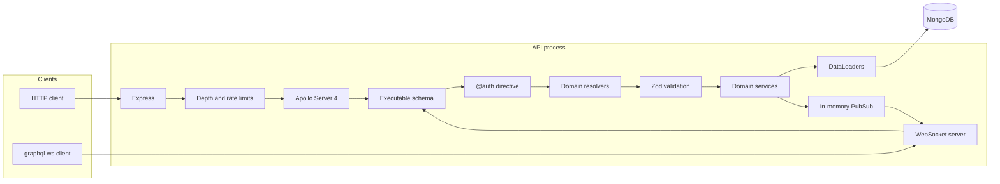

# Apollo GraphQL Starter

[](https://github.com/faheemdev78/apollo-graphql-starter/actions/workflows/ci.yml)
[](LICENSE)
[](package.json)
[](tsconfig.json)
[](https://www.apollographql.com/docs/apollo-server)
[](docker-compose.yml)

Schema-first GraphQL API starter for a small project tracker. Apollo Server 4, TypeScript, Mongoose, and `graphql-ws` are wired the way a production service starts: typed resolvers, request context, role checks, batched reads, cursor pages, and real-time task updates.

The domains are `users`, `projects`, and `tasks`. Register, open a project, add members, and stream task changes to subscribers on that project.

## Features

- Schema-first SDL in `src/graphql/typeDefs`, with `graphql-codegen` resolver types
- Modular resolvers for users, projects, and tasks
- Cursor pagination (`first` / `after`) on users, projects, and tasks
- JWT bearer auth loaded into the GraphQL context on every request
- `@auth(requires:)` directive for global roles, plus project membership checks in services
- Per-request DataLoaders for users and projects
- Task subscriptions over `graphql-ws` at `ws://localhost:4000/graphql`
- Zod input validation and a single error formatter (no stack traces in responses)
- Query depth limit and in-memory rate limit
- Idempotent seed script, Docker Compose for MongoDB and the API
- Vitest integration tests on `mongodb-memory-server`
- GitHub Actions workflow for codegen, lint, format, typecheck, and test

## Architecture



HTTP queries and mutations enter through Express. Subscriptions use the same schema on a WebSocket mounted at `/graphql`. The `@auth` directive rejects missing or under-privileged callers before the resolver runs. Services then enforce project membership, validate with Zod, and read related documents through DataLoaders created for that request. Task creates and updates publish on an in-process PubSub. That bus is correct for one API instance; a multi-instance deployment would swap it for Redis or a similar broker.

A bearer token is verified and the user is reloaded from MongoDB, so role changes apply on the next request instead of waiting for the token to expire.

## Layout

```text
src/
  auth/            JWT, password hashing, role guard
  graphql/
    typeDefs/      schema-first SDL
    generated/     codegen output
    directives/    @auth transformer
    plugins/       rate limit
  modules/         user, project, and task models, services, resolvers
  loaders/         DataLoaders
  scripts/seed.ts  demo data
tests/             Vitest integration tests
```

## Quick start

Requirements: Node.js 20 or newer, and either a local MongoDB or Docker.

```bash
cp .env.example .env
docker compose up -d mongo
npm install
npm run seed
npm run dev
```

The API listens on [http://localhost:4000/graphql](http://localhost:4000/graphql). Apollo Sandbox is embedded in development. Liveness is `GET /health`.

Run the API and MongoDB together:

```bash
cp .env.example .env
docker compose up --build
```

Compose reads `JWT_SECRET` and the other variables from `.env` when they are present, and otherwise starts with the local development defaults. Set a unique `JWT_SECRET` of at least 32 characters before `NODE_ENV=production`. The process refuses to boot in production with a placeholder secret.

### Demo accounts

`npm run seed` creates these users if they are missing. The password for every demo account is `Password123!`.

| Role   | Email             |
| ------ | ----------------- |
| ADMIN  | admin@example.com |
| MEMBER | maya@example.com  |
| VIEWER | leo@example.com   |

They share a project with key `APOLLO` and a handful of tasks. Re-running the seed keeps the users and project and only inserts tasks when the project has none.

## Environment

| Variable               | Default                                    | Purpose                                 |
| ---------------------- | ------------------------------------------ | --------------------------------------- |
| `NODE_ENV`             | `development`                              | `production` hides introspection        |
| `PORT`                 | `4000`                                     | HTTP and WebSocket port                 |
| `MONGODB_URI`          | `mongodb://127.0.0.1:27017/apollo_starter` | Mongo connection string                 |
| `JWT_SECRET`           | development placeholder                    | HMAC secret for access tokens           |
| `JWT_EXPIRES_IN`       | `7d`                                       | `jsonwebtoken` expiresIn value          |
| `CORS_ORIGIN`          | `*`                                        | Allowed browser origin, or a list       |
| `GRAPHQL_DEPTH_LIMIT`  | `8`                                        | Maximum field depth, fragments included |
| `RATE_LIMIT_MAX`       | `100`                                      | Operations per window, per user or IP   |
| `RATE_LIMIT_WINDOW_MS` | `60000`                                    | Rate-limit window                       |

`.env.example` is the template. Do not commit a real `.env`.

## Auth and roles

Send `Authorization: Bearer <token>` for HTTP. For subscriptions, pass the same header in `connectionParams`.

Global roles rank `VIEWER < MEMBER < ADMIN`.

- `VIEWER` can read projects they belong to and the tasks inside them
- `MEMBER` can create projects and change tasks where their project role is at least `MEMBER`
- `ADMIN` can read every project and change user roles
- Project owners and project admins manage members and project settings
- A project viewer cannot create or edit tasks, even if their global role is `MEMBER`

`@auth` is the global gate. Service methods return `NOT_FOUND` when the caller cannot see the project, and `FORBIDDEN` when they can see it but cannot change it.

## Example operations

Register:

```graphql
mutation Register($input: RegisterInput!) {
  register(input: $input) {
    token
    user {
      id
      email
      role
    }
  }
}
```

```json
{
  "input": {
    "email": "maya@example.com",
    "name": "Maya Chen",
    "password": "Password123!"
  }
}
```

Create a project and a task:

```graphql
mutation CreateProject($input: CreateProjectInput!) {
  createProject(input: $input) {
    id
    key
    owner {
      email
    }
    members {
      role
      user {
        name
      }
    }
  }
}
```

```graphql
mutation CreateTask($input: CreateTaskInput!) {
  createTask(input: $input) {
    id
    title
    status
    assignee {
      name
    }
  }
}
```

Page tasks, then continue with `pageInfo.endCursor`:

```graphql
query Tasks($projectId: ID!, $after: String) {
  tasks(projectId: $projectId, first: 20, after: $after, filter: { status: IN_PROGRESS }) {
    totalCount
    pageInfo {
      hasNextPage
      endCursor
    }
    edges {
      cursor
      node {
        title
        priority
        assignee {
          email
        }
        reporter {
          email
        }
      }
    }
  }
}
```

Cursors are opaque. Sort order is `createdAt` descending, then `_id` descending. `first` must be from 1 to 100.

Subscribe from a `graphql-ws` client:

```ts
import { createClient } from 'graphql-ws';

const client = createClient({
  url: 'ws://localhost:4000/graphql',
  connectionParams: {
    authorization: `Bearer ${token}`,
  },
});

client.subscribe(
  {
    query: `subscription OnTask($projectId: ID!) {
      taskUpdated(projectId: $projectId) {
        id
        title
        status
      }
    }`,
    variables: { projectId },
  },
  {
    next: (result) => console.log(result.data),
    error: (error) => console.error(error),
    complete: () => undefined,
  },
);
```

`taskUpdated` fires when a task in that project is created or updated. The caller must already be able to read the project.

curl:

```bash
curl -s http://localhost:4000/graphql \
  -H 'content-type: application/json' \
  -H "authorization: Bearer $TOKEN" \
  -d '{"query":"query { me { email role } }"}'
```

## Errors, limits, and validation

Resolver and validation failures use `extensions.code`:

| Code                   | When                                        |
| ---------------------- | ------------------------------------------- |
| `UNAUTHENTICATED`      | Missing, malformed, or expired token        |
| `FORBIDDEN`            | Role or project permission denied           |
| `BAD_USER_INPUT`       | Zod failure, bad cursor, or bad `first`     |
| `NOT_FOUND`            | Missing record, or a project you cannot see |
| `CONFLICT`             | Duplicate email or project key              |
| `RATE_LIMITED`         | Too many operations in the current window   |
| `DEPTH_LIMIT_EXCEEDED` | Selection set is deeper than the limit      |

Zod failures also include `extensions.issues` as `{ path, message }`. Unexpected errors are logged and returned as `INTERNAL_SERVER_ERROR`. Production responses omit internal messages. Request logs record the operation name and duration, not variables, so passwords do not land in the log line.

## Scripts

| Script              | Purpose                                       |
| ------------------- | --------------------------------------------- |
| `npm run dev`       | Watch mode via `tsx`                          |
| `npm run build`     | Compile to `dist` and copy SDL                |
| `npm start`         | Run the compiled server                       |
| `npm run codegen`   | Regenerate `src/graphql/generated/graphql.ts` |
| `npm run seed`      | Upsert demo users, project, and tasks         |
| `npm run lint`      | ESLint                                        |
| `npm run format`    | Prettier                                      |
| `npm test`          | Vitest integration tests                      |
| `npm run typecheck` | `tsc --noEmit`                                |
| `npm run check`     | Codegen, lint, format, typecheck, and test    |

After changing SDL, run `npm run codegen` and commit the generated file. CI fails if codegen would change it.

## Tests

Vitest boots one `mongodb-memory-server` and runs the executable schema through `executeOperation`, plus one WebSocket server test for subscriptions. Suites cover auth, cursor pages, project visibility, task filters, the DataLoader batch, depth limiting, rate limiting, and `taskUpdated`.

```bash
npm test
```

## License

[MIT](LICENSE) © 2026 faheemdev78
